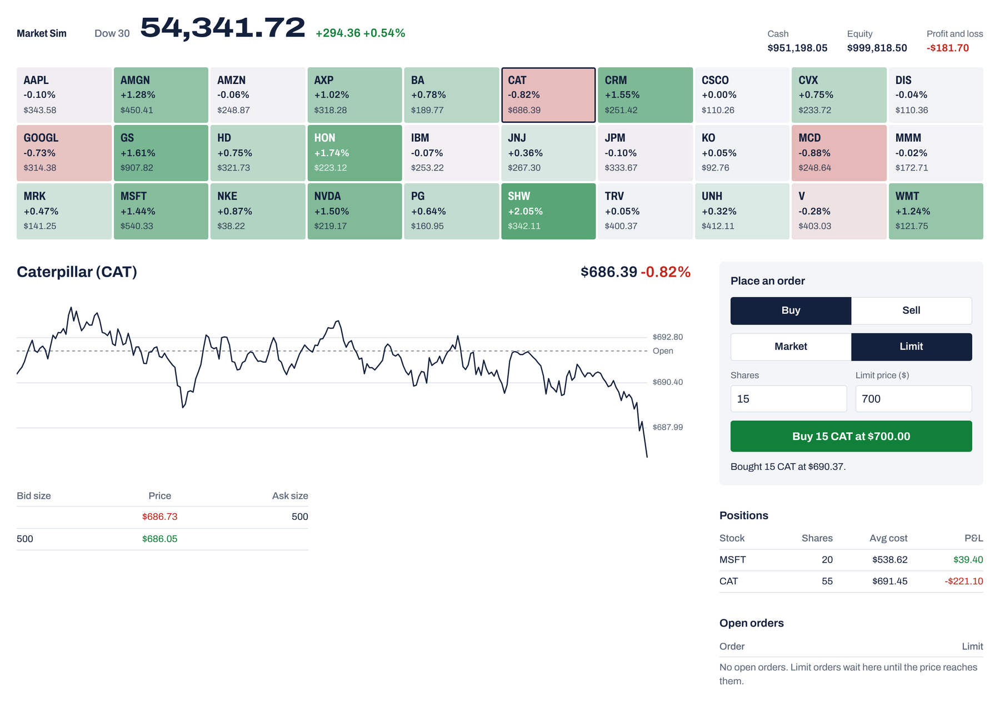

# Market Sim

A practice stock exchange for the 30 Dow stocks that runs on your own computer.



Every start is a new market. Prices move on their own and partly together. Company news and rare market shocks jump prices; after a big move a stock can stay jumpy for a while. Trading days run from 9:30 to 16:00, with a short closed gap before the next open. A market maker quotes several levels, simulated traders fire clips against it, and large trades leave a lasting price impact. You start with $1,000,000 of play money and trade from the browser, a terminal dashboard, or your own code through a REST API. Nothing is real money or real market data.

Under the hood this is a small C++20 exchange: a limit order book with price-time priority, a matching engine, a random-walk feed on a lock-free queue, pre-trade risk checks, and a portfolio. Prices are whole cents and quantities are whole shares.

## Run it

With Docker:

```bash
docker build -t market-sim .
docker run --rm -p 8080:8080 market-sim
```

Then open http://localhost:8080.

From source you need CMake 3.20+, GCC 11+ or Clang 14+, and Git (FetchContent pulls dependencies). Build a Release binary and start the server from the repository root so `config/` and `web/` are found:

```bash
cmake -S . -B build -DCMAKE_BUILD_TYPE=Release
cmake --build build --target marketsim_server
./build/marketsim_server
```

## Ways to trade

**Browser.** The board is coloured by each stock's move from previous close (or from the open on day one). The header shows the session clock. Click a stock for its chart, order book, market tape and volume. News headlines sit under the book. Orders are rejected while the market is closed. Market orders fill at once against the market maker; limit orders wait on the book until the price reaches them.

**Terminal.** `marketsim_dashboard` opens on the market overview: arrow keys (or `j`/`k`) and Enter pick a stock, `o` returns to the overview, `[` and `]` step through symbols, `q` quits. Tab moves between the order controls; prices there are in cents.

**Your own code.** Talk to the REST API on the same process as the feed:

| Method | Path | Purpose |
|--------|------|---------|
| `POST` | `/api/v1/orders` | Place an order. Body: `symbol`, `side` (`buy`/`sell`), `type` (`limit`/`market`), `quantity`, `price_cents` for limits, optional `client_id`. |
| `DELETE` | `/api/v1/orders/<id>` | Cancel a resting order. |
| `GET` | `/api/v1/orders` | List your resting orders. |
| `GET` | `/api/v1/symbols` | Configured symbols with `name`, `last_price_cents`, `open_price_cents`, `previous_close_cents`, and `volume`. Open and previous close are null until they exist. |
| `GET` | `/api/v1/index` | Price-weighted index (`name`, `value`, `open_value`, `previous_close`). `404` when no index is configured. |
| `GET` | `/api/v1/clock` | Session clock (`day`, `minute_of_day`, `open`). |
| `GET` | `/api/v1/news` | Recent headlines (`day`, `minute_of_day`, `symbol`, `name`, `move`). Market-wide rows have a null `symbol`. |
| `GET` | `/api/v1/tape/<SYM>` | Market tape for one symbol (`minute_of_day`, `price_cents`, `quantity`, `aggressive_side`), newest first. |
| `GET` | `/api/v1/quote/<SYM>` | Top of book; includes `last_price_cents`. |
| `GET` | `/api/v1/orderbook/<SYM>` | Depth snapshot. |
| `GET` | `/api/v1/portfolio` | Cash, equity, positions. |
| `GET` | `/api/v1/trades` | Your trades (`side` = your side, `aggressive_side` = the side that crossed the spread). |

Errors return JSON with a stable `"error"` code and a `"message"`; `400` malformed request, `404` unknown symbol/order/route, `422` rejected by risk, the engine, or `market_closed`.

```bash
curl -sS -X POST http://127.0.0.1:8080/api/v1/orders \
  -H 'Content-Type: application/json' \
  -d '{"symbol":"AAPL","side":"buy","type":"market","quantity":10}'
```

Crossing your own resting order cancels that resting order instead of trading (self-trade prevention); successful place responses include `self_trade_cancelled_order_ids` (possibly empty).

## Programs

| Binary | Arguments | REST / web UI | Terminal UI |
|--------|-----------|---------------|-------------|
| `marketsim_server` | `[port] [path/to/symbols.json]` | yes (`0.0.0.0:8080` by default; serves `web/` at `/`) | no |
| `marketsim_dashboard` | `[SYMBOL] [path/to/symbols.json]` | no | yes |
| `marketsim_demo` | `[port] [path/to/symbols.json] [ui_focus_symbol]` | yes (`127.0.0.1`; serves `web/` at `/`) | yes |

Run them from the repository root (or pass an explicit config path). If the config file is missing or invalid, built-in defaults apply. Stop with Ctrl+C (SIGINT/SIGTERM): the HTTP thread stops and joins, then the feed threads stop.

## Configuration

`config/symbols.json` sections:

- **symbols** — each object has `symbol`, optional `name`, `initial_price_cents`, `volatility`, `drift`, and `market_correlation` (0 = independent of the shared market move, 1 = fully tied to it). Tickers that are not in the built-in default table need a positive `initial_price_cents` or they are skipped with a warning.
- **index** — `name` and `divisor`. The index value is the sum of last prices in dollars divided by the divisor, the way the Dow is computed. A divisor of `0` (or a missing section) disables the index. The checked-in divisor is approximate.
- **feed** — optional `seed`, plus `dt_years` and `pump_interval_ms`. Omit `seed` for a fresh draw each start; set it to replay the same path. The checked-in timing makes one real second about one market minute, so a trading day takes about six and a half minutes.
- **clock** — `closed_seconds` for the overnight gap between the 16:00 close and the next 9:30 open.
- **news** — `company_news_per_day` and `market_shocks_per_day` (expected counts per trading day).
- **account** — `cash_cents` and the limits `max_order_size`, `max_position_per_symbol`, `min_price_cents`, `max_price_cents`, `price_collar_cents`; `0` disables a limit.
- **market_maker** — `enabled`, `half_spread_bps`, `quote_size`, `levels`, and `impact_bps_per_1000_shares`.
- **bots** — `enabled` and `activity` (scales how often simulated traders fire).

Missing sections use built-in defaults. See the checked-in file for shape.

## Tests

```bash
cmake -S . -B build -DCMAKE_BUILD_TYPE=Debug
cmake --build build
ctest --test-dir build --output-on-failure
```

Debug builds use `-Werror` and AddressSanitizer/UBSan by default. CMake switches: `-DMARKETSIM_WERROR=OFF` and `-DMARKETSIM_SANITIZE=OFF`. CI runs the same build and tests with GCC and Clang on pushes to main and pull requests, plus a Release build.

## How it fits together

| Path | Purpose |
|------|---------|
| `include/marketsim/`, `src/` | Headers and implementations: domain, order book, matching, event bus, feed, portfolio, config, runtime, gateway, view, UI |
| `web/` | Browser UI (plain HTML, CSS, JavaScript) |
| `tests/` | GoogleTest suites |
| `config/` | Runtime JSON |

- **Layers:** `domain` types and market structs → `orderbook` / `matching` → `portfolio` + `risk` → `gateway::SimulatorService` (HTTP façade) → `view` read models for the UI → `ui` formatting and FTXUI. The browser talks only to the REST API.
- **Threads:** `SimulatorRuntime` runs a producer (GBM ticks, clock updates and news pushed to an SPSC ring) and a consumer (applies marks, clock and headlines; requotes the market maker; runs simulated traders). HTTP runs on its own thread in server/demo binaries. The service uses one mutex for all mutations and reads through its public API.
- **Design choices:** Integer money avoids rounding bugs in core logic. The SPSC queue matches one writer and one reader; ticks can be dropped if the ring is full. The terminal UI uses `capture_view_snapshot` (structs) rather than parsing JSON.

## Known limitations

Resting buy orders do not reserve cash. Market buys are checked against the latest feed price but fill at the maker's ask. There is one trader account and nothing is saved; state resets on restart. The browser chart starts empty when the page opens and only keeps prices collected while that tab is open. Simulated traders have no portfolio of their own.

## Contributing

See [CONTRIBUTING.md](CONTRIBUTING.md) for how to build, test, and send a change.
