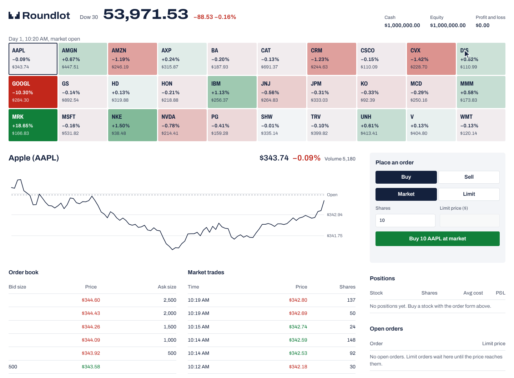

# Market Sim

[](https://github.com/mert-ogul/Market-Sim/actions/workflows/ci.yml)

A practice stock exchange for the 30 Dow stocks that runs on your own computer.



You start with $1,000,000 of play money and trade from the browser, a terminal dashboard, or your own code through a REST API. Nothing here is real money or real market data.

- Every start is a new market. Prices move on their own and partly together, so some days the whole board turns red.
- Company news jumps a single stock by 5 to 20 percent, and now and then a shock hits the whole market. A stock stays jumpy for a while after a big move.
- Trading days run from 9:30 to 16:00, with a short closed break and a price gap at the next open.
- A market maker quotes five price levels a side, simulated traders keep the tape busy, and a large order of yours moves the price for good.
- Underneath is a small C++20 exchange: a limit order book with price-time priority, a matching engine, pre-trade risk checks and a portfolio, with prices in whole cents.

## Run it

With Docker:

```bash
docker build -t market-sim .
docker run --rm -p 8080:8080 market-sim
```

Then open http://localhost:8080.

From source you need CMake 3.20+, GCC 11+ or Clang 14+, and Git. CMake downloads the other dependencies while it configures.

```bash
cmake -S . -B build -DCMAKE_BUILD_TYPE=Release
cmake --build build -j
./build/marketsim_server
```

Start it from the repository root so it finds `config/` and `web/`. The first lines it prints include the market's seed; put that number in the config to replay the same market.

## Ways to trade

**Browser.** Tiles are coloured by each stock's move since the previous close (since the open on day one), and the line under the header shows the market clock. Click a stock for its chart, order book, latest market trades and volume. Headlines collect under News. Market orders fill at once against the market maker, and large ones walk to worse prices; limit orders wait on the book until the price reaches them. Orders are rejected while the market is closed.

**Terminal.** `./build/marketsim_dashboard` opens on a market overview. Arrow keys (or `j` and `k`) and Enter open a stock, `o` goes back to the overview, `[` and `]` step through stocks, and `q` quits. Tab moves between the order controls, where prices are in cents.

**Your own code.** The browser uses the same REST API you do:

```bash
curl -sS -X POST http://127.0.0.1:8080/api/v1/orders \
  -H 'Content-Type: application/json' \
  -d '{"symbol":"AAPL","side":"buy","type":"market","quantity":10}'
```

| Method | Path | Returns |
|--------|------|---------|
| `POST` | `/api/v1/orders` | Places an order. Body: `symbol`, `side` (`buy` or `sell`), `type` (`limit` or `market`), `quantity`, `price_cents` for limits, optional `client_id`. |
| `DELETE` | `/api/v1/orders/<id>` | Cancels a resting order. |
| `GET` | `/api/v1/orders` | Your resting orders. |
| `GET` | `/api/v1/portfolio` | Cash, equity, positions and profit. |
| `GET` | `/api/v1/trades` | Your trades. `side` is your side; `aggressive_side` is the side that crossed the spread. |
| `GET` | `/api/v1/symbols` | Every stock with `name`, `last_price_cents`, `open_price_cents`, `previous_close_cents` and today's `volume`. |
| `GET` | `/api/v1/index` | The index `name`, `value`, `open_value` and `previous_close`. |
| `GET` | `/api/v1/quote/<SYM>` | Best bid and ask, plus `last_price_cents`. |
| `GET` | `/api/v1/orderbook/<SYM>` | Depth of the book. |
| `GET` | `/api/v1/tape/<SYM>` | The latest trades in one stock by anyone, newest first. |
| `GET` | `/api/v1/clock` | `day`, `minute_of_day` (570 is 9:30) and whether the market is `open`. |
| `GET` | `/api/v1/news` | Recent headlines, newest first. `symbol` is null for market-wide news, and `move` is -0.14 for a 14% drop. |

Errors come back as JSON with a stable `error` code and a readable `message`: `400` for a malformed request, `404` for an unknown symbol, order or route, and `422` when risk checks or the matching engine reject an order or the market is closed (`market_closed`). An order that would trade with one of your own resting orders cancels that resting order instead; its id is listed in `self_trade_cancelled_order_ids`.

## Programs

| Binary | Arguments | Web UI and REST | Terminal UI |
|--------|-----------|-----------------|-------------|
| `marketsim_server` | `[port] [config]` | yes, on `0.0.0.0:8080` | no |
| `marketsim_dashboard` | `[SYMBOL] [config]` | no | yes |
| `marketsim_demo` | `[port] [config] [SYMBOL]` | yes, on `127.0.0.1` | yes, on the same market |

`config` defaults to `config/symbols.json`; if it is missing or invalid, built-in defaults apply. Stop any of them with Ctrl+C.

## Configuration

Everything lives in [`config/symbols.json`](config/symbols.json). Missing sections fall back to defaults.

| Section | Keys | Notes |
|---------|------|-------|
| `symbols` | `symbol`, `name`, `initial_price_cents`, `volatility`, `drift`, `market_correlation` | Volatility and drift are yearly. Correlation runs from 0 (ignores the market) to 1 (moves with it). A ticker outside the built-in table needs `initial_price_cents`. |
| `index` | `name`, `divisor` | Sum of prices divided by the divisor, like the Dow. A divisor of 0 turns the index off. |
| `feed` | `dt_years`, `pump_interval_ms`, `seed` | The checked-in timing makes one real second about one market minute, so a day takes about 6.5 minutes. Leave `seed` out for a new market on every start. |
| `clock` | `closed_seconds` | Real seconds the market stays closed between two days. |
| `news` | `company_news_per_day`, `market_shocks_per_day` | Expected news per stock, and shocks per market, each trading day. 0 turns them off. |
| `account` | `cash_cents`, `max_order_size`, `max_position_per_symbol`, `min_price_cents`, `max_price_cents`, `price_collar_cents` | A limit of 0 is off. |
| `market_maker` | `enabled`, `half_spread_bps`, `quote_size`, `levels`, `impact_bps_per_1000_shares` | Level k sits k half-spreads out with k times `quote_size`. |
| `bots` | `enabled`, `activity` | 1 is the normal pace; 2 trades twice as often. |

## How it works

One process runs two threads joined by a lock-free queue. The producer moves the market clock and the price feed and publishes ticks and news; the consumer applies them to `SimulatorService`, which holds the order book, the portfolio and the market maker behind a single mutex. HTTP requests and the terminal UI read and trade through that same service.

Prices follow geometric Brownian motion with a shared market factor, plus jumps from news and a volatility multiplier that decays after them. Money is integer cents throughout the C++ code.

The dependencies are [nlohmann/json](https://github.com/nlohmann/json), [cpp-httplib](https://github.com/yhirose/cpp-httplib), [FTXUI](https://github.com/ArthurSonzogni/FTXUI) and [GoogleTest](https://github.com/google/googletest), all fetched by CMake. The web UI is plain HTML, CSS and JavaScript with no build step.

[docs/ARCHITECTURE.md](docs/ARCHITECTURE.md) has the code map, the threading model, the rules the code keeps and the exact market model.

## Tests

```bash
cmake -S . -B build -DCMAKE_BUILD_TYPE=Debug
cmake --build build -j
ctest --test-dir build --output-on-failure
```

Debug builds treat warnings as errors and turn on AddressSanitizer and UBSan; `-DMARKETSIM_WERROR=OFF` and `-DMARKETSIM_SANITIZE=OFF` switch those off. CI runs the tests with GCC and Clang and checks a Release build on every pull request.

## Known limitations

- Resting buy orders don't reserve cash, so several of them together can add up to more than you have.
- Market buys are checked against the last price but fill at the maker's ask, which can be a few levels higher for a large order.
- There is one trader account and nothing is saved; the market starts over when the server restarts.
- The browser chart starts when the page opens. There is no price history endpoint yet.

## Contributing

Bug reports and pull requests are welcome. [CONTRIBUTING.md](CONTRIBUTING.md) explains how to build, what a good pull request looks like, and lists a few good first issues.
