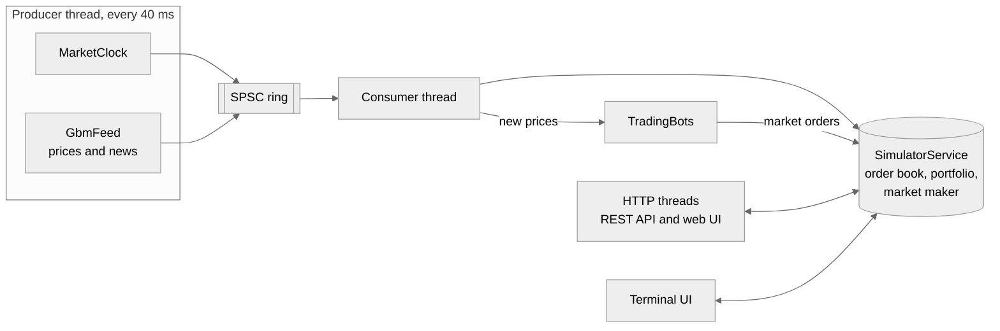

# Architecture

This is a map of the code for people who want to change it: where things live and which rules the code keeps. How a single function works is left to the code and its comments.

## The short version

Roundlot is one process. A price feed makes up prices, a market maker quotes around them, and orders from you and from simulated traders meet in a limit order book. Everything you see in the browser, the terminal or over HTTP is read from one object, `SimulatorService`, behind one mutex.



The ring carries three kinds of event: clock states, price ticks and news. The consumer hands each one to `SimulatorService` (`apply_clock`, `apply_mark_from_tick`, `record_news`) and then shows each new price to the bots.

## Code map

Headers are under `include/marketsim/<area>/`, sources under `src/`.

| Area | What is there |
|------|---------------|
| `domain` | Plain types with no logic: `Order`, `Trade`, `Position`, `Tick`, `News`, `MarketClockState` and the settings structs. Account ids live in `types.hpp`. |
| `orderbook` | `OrderBook`, one per symbol. Price levels sit in a `std::map`, the orders at a level in a `std::list`, and an id index makes a cancel O(1). |
| `matching` | `MatchingEngine` owns the books and matches limit and market orders by price, then time. An order that would trade with its owner's own resting order cancels that order instead. |
| `feed` | `GbmFeed` and `gbm_model.hpp`: the price model, news and stormy periods. `gbm_runner.hpp` pushes ticks and news into the ring. |
| `eventbus` | `SpscRing`, a lock-free queue for one writer and one reader, and the `Event` variant it carries. |
| `portfolio` | `Portfolio` (cash, positions, average cost, profit) and `RiskManager` (checks before an order reaches the book). |
| `bots` | `TradingBots`: three short rules that turn a new price into market orders. |
| `runtime` | `SimulatorRuntime` owns the feed, the clock, the ring, the bots and both threads. `MarketClock` counts trading days. |
| `gateway` | `SimulatorService`, request parsing and the HTTP routes. |
| `view`, `ui` | The terminal dashboard. `capture_view_snapshot` copies service state into structs, and FTXUI draws them. |
| `config` | Reads `config/symbols.json` and falls back to built-in defaults for anything missing. |

Outside the C++ tree, `web/` is the browser UI (static files the server hands out, polling the REST API) and `tests/` has one GoogleTest file per area.

CMake builds four libraries. `marketsim_core` has the book, matching, feed, portfolio and risk. `marketsim_runtime` adds config, the runtime and the bots. `marketsim_ui_model` and `marketsim_dashboard_driver` hold the terminal UI. Only `marketsim_server` and `marketsim_demo` link cpp-httplib.

## Rules the code keeps

- Money is integer cents (`PriceCents`) everywhere except inside the price model. Doubles are rounded to cents once, where a price leaves the feed or the price impact is applied.
- The feed never reads the order book. Trading moves prices only through the per-symbol price shift in `SimulatorService`, so the random walk itself stays reproducible.
- `SimulatorService` is the only shared state. Every public method takes its mutex, and there are no other locks on the trading path.
- The producer never waits. If the ring is full, a tick is dropped; the next one carries the newer price anyway.
- Only your account (1) is risk-checked and has a portfolio. The market maker (2) and the simulated traders (3, 4 and 5) trade without either.
- The browser has no private endpoints. Anything the web UI shows, a script can get from the same REST API.

## Market model

**Prices.** Each symbol follows geometric Brownian motion, one step per tick:

```math
S_{t+\Delta t} = S_t \exp\left(\left(\mu - \tfrac{\sigma^2}{2}\right)\Delta t + \sigma\sqrt{\Delta t}\,z\right), \qquad z = \rho M + \sqrt{1-\rho^2}\,\varepsilon
```

μ and σ are the yearly `drift` and `volatility` from the config, and Δt is `dt_years`. M is one standard normal draw shared by every symbol in a round, ε is the symbol's own draw, and ρ is its `market_correlation`. With `dt_years` at 4e-07 and a tick every 40 ms, one real second is about one market minute.

**News.** On each tick, a stock gets company news with probability `company_news_per_day` times the trading days per tick. The move is 5 to 20 percent, up or down with even odds. A market shock works the same way with `market_shocks_per_day`, but it moves the whole market 2 to 7 percent, down four times out of five. Each stock takes `move * (0.5 + 0.5 * market_correlation)` of it, so closely tied stocks fall harder.

**Stormy periods.** Every jump raises the stock's volatility multiplier by ten times the size of the move, up to four times normal. The extra volatility halves every trading day.

**Trading days.** `MarketClock` runs a session from 9:30 to 16:00 and then stays closed for `closed_seconds` of real time. While closed, the feed keeps stepping but publishes nothing, so the next open starts with a gap. On a new day the service keeps the last prices as the previous close and starts the day's open, volume and tape again.

**Market maker.** On every tick it cancels its quotes and puts up new ones. Level k on each side sits k half-spreads from the price and holds k times `quote_size`, so a large order walks to worse prices. When someone takes its quotes, the symbol's price shift moves by `quantity / 1000 * impact_bps_per_1000_shares` basis points, up for buys and down for sells. The shift stays in place for every later tick.

**Simulated traders.** `TradingBots` sees every new price. At `activity` 1, per tick and symbol:

| Trader | Chance | Order |
|--------|--------|-------|
| Random trader | 3% | 10 to 200 shares, buy or sell |
| Trend follower | 2% | 100 to 600 shares in the direction of a move of 0.3% or more over the last 150 ticks |
| Bargain hunter | 1.5% | 100 to 600 shares against a move of 2% or more from the previous close |

**Index.** The sum of all last prices in dollars divided by the configured divisor, the way the Dow is calculated.

## Randomness and replay

Each run has one seed: `feed.seed` from the config, or a fresh value from `std::random_device` mixed with the clock. The server prints it at startup. The per-symbol draws, the market draw, news and the bots each get their own stream derived from that seed, so turning news off leaves the normal price paths unchanged. With a fixed seed the feed, news and clock repeat exactly. The bots repeat too until you trade or a tick is dropped, since both change the prices they react to.

## Threads and shutdown

The producer advances the clock, pushes its state, steps every symbol and pushes ticks and news, then sleeps for `pump_interval_ms`. The consumer drains the ring and applies each event to the service, then lets the bots react to each new price. HTTP requests run on cpp-httplib's own threads and hold the service mutex only for the length of a call.

On Ctrl+C the server stops the HTTP listener and joins it first, then stops the runtime, which joins the producer and then the consumer.

## Tests

`tests/` has unit tests for each area and integration tests that run the service and a real HTTP server in-process. Debug builds turn on `-Werror`, AddressSanitizer and UBSan. CI builds and tests Debug with GCC and Clang, plus a Release build, on every pull request.
